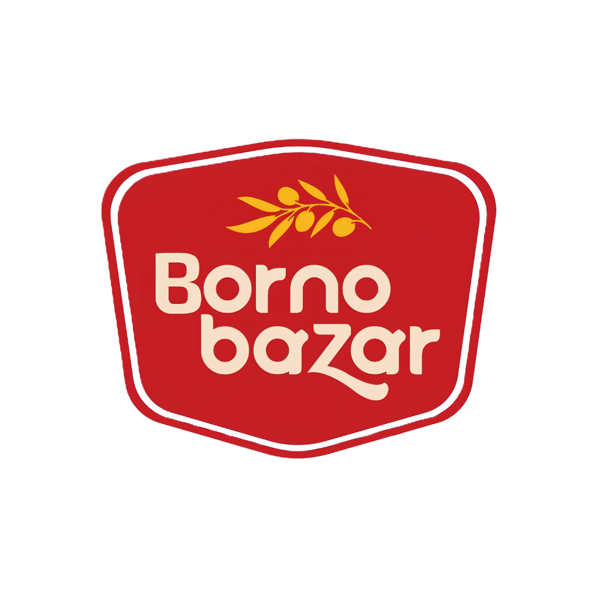

# বর্ণবাজার (Bornobazar) — স্বাদ ও মানে অনন্য!

<p align="center">
  
</p>

<p align="center">
  <strong>রোদে শুকানো খাঁটি আচার, শুটকি ভর্তা ও ঐতিহ্যবাহী ঘরোয়া খাদ্যসম্ভার</strong><br>
  <em>ঘানিভাঙা খাঁটি সরিষার তেলে রোদে শুকিয়ে প্রস্তুতকৃত সনাতন ঘরোয়া স্বাদ — কোনো ক্ষতিকর কেমিক্যাল বা কৃত্রিম সিরকামুক্ত।</em>
</p>

<p align="center">
  <a href="https://xixify.github.io/bornobazar/"></a>
  
  
  
</p>

---

## 🌐 লাইভ ওয়েবসাইট (Live Website)

🔗 **লাইভ প্রিভিউ লিঙ্ক:** **[https://xixify.github.io/bornobazar/](https://xixify.github.io/bornobazar/)**

---

## 🌿 পরিচিতি (About Bornobazar)

**বর্ণবাজার (Bornobazar)** একটি ঐতিহ্যবাহী বাংলাদেশি কনজিউমার ফুড ব্র্যান্ড, যার মূল ভিত্তি ও প্রস্তুতকেন্দ্র মেহেরপুর জেলার ঐতিহাসিক মুজিবনগরের দাড়িয়াপুরে অবস্থিত। 

আমরা সরবরাহ করি:
- 🥭 **রোদে শুকানো খাঁটি আচার:** আম, বরই, জলপাই, চালতা, তেঁতুল, আলুবোখারা, রসুন ও কালোজিরা সহ ১৩+ রকমের খাঁটি আচার।
- 🐟 **মুখরোচক শুটকি মাছের ভর্তা:** ইলিশ, চিংড়ি, লইট্টা, ছুরি ও বাঁশপাতা শুটকি ভর্তা।
- 🎁 **স্পেশাল গিফট কম্বো:** ৬ প্যাক মাস্টার কম্বো, পাহাড়ি আচার কম্বো, শাহজাদা ও শাহজাদী কম্বো।
- 🍯 **খাঁটি খেজুরের গুড় ও নাড়ু:** যশোরের ঐতিহ্যবাহী পাটালি খেজুরের গুড় ও দেশি নারিকেল নাড়ু।

---

## ✨ প্রধান বৈশিষ্ট্যসমূহ (Key Highlights)

- 🎨 **জিরো-গ্রেডিয়েন্ট (Zero-Gradient) ডিজাইন আর্কিটেকচার:** কৃত্রিম এআই গ্রেডিয়েন্ট সম্পূর্ণ বর্জন করে মাটির রঙ, সরিষার তেলের সোনালি আভা ও উষ্ণ রঙের সমন্বয়ে নির্মিত প্রিমিয়াম আর্ট-ডিরেক্টেড ইউজার ইন্টারফেস।
- 📱 **মোবাইল-ফার্স্ট রেসপনসিভনেস:** স্মার্টফোন ও ট্যাবলেটে স্মুথ ইউজার এক্সপেরিয়েন্স, মোবাইল বটম বার, ওয়ান-ট্যাপ কার্ট ড্রয়ার এবং মোবাইল প্রোডাক্ট পেজে ডাইনামিক স্টিকি অ্যাড-টু-কার্ট।
- 🛒 **রিয়েল-টাইম ইন্টারঅ্যাক্টিভ কার্ট:** লোকালস্টোরেজ ভিত্তিক কার্ট ম্যানেজমেন্ট, লাইভ আইটেম কাউন্টার, ফ্রি ডেলিভারি প্রগ্রেস বার এবং ইনস্ট্যান্ট কোয়ান্টিটি আপডেট।
- 🇧🇩 **১-পেজ বাংলাদেশি চেকআউট:** বাংলাদেশের গ্রাহকদের জন্য ক্যাশ অন ডেলিভারি (COD) এবং মোবাইল ব্যাংকিং (বিকাশ/নগদ) সাপোর্টেড সিম্পল সিঙ্গেল-পেজ ফর্ম।
- ⚡ **জিরো থার্ড-পার্টি ডিপেনডেন্সি:** সম্পূর্ণ লাইটওয়েট ভ্যানিলা এইচটিএমএল, পিওর সিএসএস৩ এবং মডার্ন জাভাস্ক্রিপ্ট দিয়ে তৈরি — কোনো ভারী ফ্রেমওয়ার্ক ছাড়া সুপারফাস্ট লোডিং স্পিড।
- 🔍 **সার্চ ইঞ্জিন অপ্টিমাইজড (SEO & Schema.org):** বাংলা ও ইংরেজি মেটা ট্যাগ, ওপেন গ্রাফ ট্যাগ এবং সম্পূর্ণ Schema.org JSON-LD (Store, Product, BreadcrumbList) সমন্বিত।

---

## 📂 প্রজেক্ট স্ট্রাকচার (Repository Structure)

```plaintext
bornobazar/
├── index.html                     # হোমপেজ (হিরো ব্যানার, ফিচার্ড ক্যাটাগরি, বেস্টসেলার, রিভিউ)
├── shop.html                      # শপ / ক্যাটালগ পেজ (লাইভ ফিল্টার, সার্চ ও সর্টিং)
├── product.html                   # প্রোডাক্ট ডিটেইল পেজ (ভ্যারিয়েশন, পুষ্টিমান ও রিলেটেড আইটেম)
├── cart.html                      # পূর্ণাঙ্গ শপিং কার্ট পেজ
├── checkout.html                  # ১-পেজ বাংলাদেশি চেকআউট পেজ (ক্যাশ অন ডেলিভারি)
├── about.html                     # আমাদের গল্প, ফ্যাক্টরি ও ঐতিহ্য
├── faq.html                       # সাধারণ জিজ্ঞাসা ও প্রশ্নোত্তর
├── contact.html                   # যোগাযোগ ও কাস্টমার সাপোর্ট
├── css/
│   └── styles.css                 # কেন্দ্রীয় ডিজাইন সিস্টেম, সিএসএস ভ্যারিয়েবল ও স্টাইল
├── js/
│   └── main.js                    # কার্ট, ফিল্টার, সার্চ, ড্রয়ার ও ইন্টারঅ্যাকশন স্ক্রিপ্ট
├── data/
│   ├── products.json              # ২৮টি প্রোডাক্টের স্ট্রাকচার্ড ডাটাবেজ
│   └── products-data.js           # ক্লায়েন্ট-সাইড প্রোডাক্ট ডাটা অবজেক্ট
├── Logo/
│   └── bornobazar-logo.png        # অফিসিয়াল ক্রপ-মুক্ত স্বচ্ছ লোগো
├── All images/                    # ১৩০+ আসল ও প্রামাণ্য ফটোগ্রাফি অ্যাসেট
└── documentation/                 # সম্পূর্ণ প্রজেক্ট আর্কিটেকচার ও রিসার্চ রিপোর্ট
    ├── brand-research.md          # ব্র্যান্ড পজিশনিং ও বিএসটিআই সনদের নথি
    ├── product-audit.md           # বানান প্রমিতকরণ ও ভ্যারিয়েশন ম্যাপিং
    ├── design-system.md           # জিরো-গ্রেডিয়েন্ট ডিজাইন সিস্টেম গাইড
    ├── seo-plan.md                # মেটা ট্যাগ ও Schema.org স্ট্র্যাটেজি
    ├── wordpress-implementation-plan.md  # উকমার্স থিম রূপান্তর গাইড
    └── completion-report.md       # চূড়ান্ত কমপ্লিশন ও হ্যান্ডওভার রিপোর্ট
```

---

## 🚀 লোকাল সার্ভারে রান করার নিয়ম (Local Development)

কোনো ইনস্টলেশন বা জটিল কনফিগারেশন ছাড়াই যেকোনো লোকাল এইচটিটিপি সার্ভারে সাইটটি রান করা যায়:

### অপশন ১: পাইথন ব্যবহার করে (Python Built-in)
```bash
python -m http.server 3000
```
ব্রাউজারে ভিজিট করুন: `http://localhost:3000`

### অপশন ২: Node.js / npx ব্যবহার করে
```bash
npx serve . -l 3000
```

---

## 📑 বিস্তারিত ডকুমেন্টেশন (Architecture & Documentation)

প্রকল্পের প্রতিটি কারিগরি ও ব্যবসায়িক দিক বিস্তারিতভাবে `documentation/` ফোল্ডারে নথিভুক্ত করা আছে:

1. [ব্র্যান্ড রিসার্চ ও পরিচিতি (Brand Research)](documentation/brand-research.md)
2. [মাস্টার প্রোডাক্ট অডিট (Product Audit)](documentation/product-audit.md)
3. [ডিজাইন সিস্টেম স্পেসিফিকেশন (Design System)](documentation/design-system.md)
4. [এসইও ও মেটাডাটা পরিকল্পনা (SEO Plan)](documentation/seo-plan.md)
5. [উকমার্স টেকনিক্যাল হ্যান্ডওভার প্ল্যান (WordPress Plan)](documentation/wordpress-implementation-plan.md)
6. [চূড়ান্ত প্রকল্প সমাপ্তি রিপোর্ট (Completion Report)](documentation/completion-report.md)

---

## 📜 কপিরাইট ও সত্ত্বাধিকার (Copyright)

© ২০২৬ **বর্ণবাজার (Bornobazar)** — সর্বস্বত্ব সংরক্ষিত।  
*ফ্যাক্টরি:* দাড়িয়াপুর, মুজিবনগর, মেহেরপুর, বাংলাদেশ।
